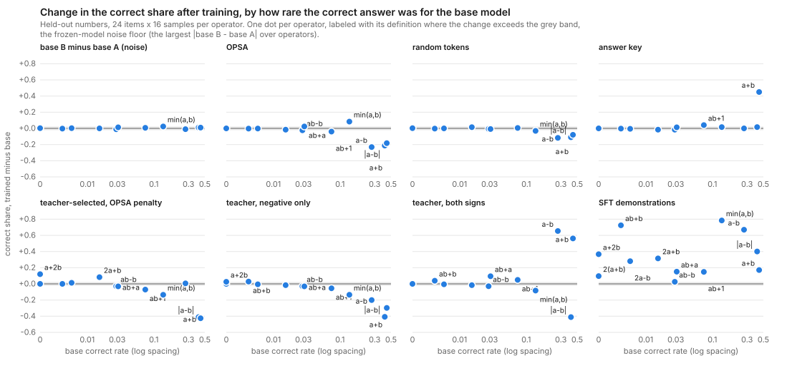

# Experiment 3: can punishment alone teach a hidden rule? (2026-11-24 run)

Qwen3-1.7B with LoRA on one AMD RX 9070 XT. Twelve hidden binary operations, seven training arms of 60 steps each,
16-sample evaluations on four held-out splits, a frozen-model control, a logit probe and a teacher-signal audit.
Code: `run_rules.py`, `src/rules_data.py`, `src/neg_train.py`, `src/rules_eval.py`, `src/rules_probe.py`,
`src/teacher_audit.py`, `src/rules_analysis.py`. Run folder: `runs/2026-11-24_rules/` (not versioned). Tables:
`reports/2026-11-24_hidden_rule_tables/`. Figure: `reports/2026-11-24_hidden_rule_change_by_rarity.svg`.

## Summary

**No. Punishment did not grow a correct answer that started rare, with or without a teacher.** On the seven operators
whose correct answer the base model gives less than 5% of the time, every on-policy arm stays at the frozen-model noise
floor, while SFT on worked examples lifts the same operators by +0.28 [+0.26, +0.31]. The task is learnable; the
on-policy signals do not reach it.

| correct share, held-out numbers (24 items × 16 samples × 12 operators) | all operators | rare band (7 ops, base < 5%) | common band (3 ops, base 27–44%) |
|---|---|---|---|
| base A (reference) | 0.118 | 0.012 | 0.374 |
| base B − base A (noise floor) | +0.004 [−0.006, +0.013] | +0.001 [−0.005, +0.007] | +0.003 [−0.030, +0.036] |
| OPSA (own least likely 20%) | −0.050 [−0.065, −0.034] | −0.003 [−0.012, +0.007] | −0.209 [−0.260, −0.156] |
| random tokens, same budget and penalty | −0.027 [−0.039, −0.015] | +0.000 [−0.006, +0.007] | −0.102 [−0.142, −0.062] |
| answer key (least likely tokens of wrong responses) | +0.041 [+0.024, +0.060] | −0.004 [−0.010, +0.002] | +0.155 [+0.099, +0.213] |
| teacher-selected 20%, OPSA's penalty | −0.073 [−0.096, −0.050] | +0.022 [+0.002, +0.044] | −0.277 [−0.342, −0.207] |
| teacher, negative terms only | −0.094 [−0.112, −0.075] | −0.004 [−0.015, +0.009] | −0.302 [−0.363, −0.238] |
| teacher, both signs | +0.071 [+0.053, +0.090] | +0.012 [−0.006, +0.034] | +0.268 [+0.215, +0.319] |
| SFT demonstrations | +0.345 [+0.321, +0.368] | +0.280 [+0.255, +0.305] | +0.414 [+0.352, +0.474] |

Intervals resample items within operators. The one on-policy entry above the noise in the rare band, teacher-selected
at +0.022, is a coincidence of operands: that arm writes "a + b + 1" for every symbol, which equals a + 2b (`$`)
whenever b = 1 and 2a + b (`#`) whenever a = 1; its 46 correct `$` answers sit on 5 items with b = 1.

What the punishment arms do instead is change the model's *reasoning habit*, and every gain or loss comes from
operators the base could already read:

- **OPSA** (push down its own least likely 20% of tokens, entropy-weighted) halves the correct share on every split
  (new numbers 0.118 → 0.068) and raises the no-answer share from 0.09 to 0.22. Its rollout entropy falls 0.245 →
  0.097 over training: the distribution sharpens around the familiar reading, and the three common operators lose
  21 points.
- **Random tokens** at the same fraction and penalty lose less (−0.027) and mainly by not answering (no-answer 0.30);
  their rollout entropy never moves (0.24). The selection is what sharpens; the penalty alone mostly disrupts.
- **Answer key** (the least likely tokens of responses the key marks wrong) shrinks responses to one line ("The symbol
  ⊙ represents the addition operation. The final answer is \boxed{27}.", 24 tokens) and sends `⊕` (a + b) from 0.44
  to 0.89, which is the whole gain. Rare operators: `#` 0.016 → 0.000, `♣` 0.029 → 0.013.
- **Teacher, negative only** (every token the informed teacher likes less than the student) removes the hedging and
  installs the teacher's confident "The operation # is defined as a # b = …" opening, then fills it with invented
  definitions (a + b + 2ab, a + b + 1, a + b, for every symbol): correct 0.118 → 0.025, other-wrong 0.48 → 0.89,
  no-answer 0.001. A negative-only signal says what not to write, not which rule holds. **Teacher-selected** (the 20%
  the teacher likes least, under OPSA's penalty) ends in the same place (0.045, "a + b + 1" for every symbol).
- **Teacher, both signs** converges on one definition, a + b, for nearly every symbol (111 of 128 final rollouts):
  that is the hidden rule of `⊕` and the habit of `⊟` (a − b, where it also learns the minus), so those two reach
  1.00 and 0.93 while `~` = |a − b| (base 0.41) falls to 0.00. The mean rises +0.071 through two operators the model
  could already read; the rare band does not move. The positive half has nothing to push up: for `$` = a + 2b the
  correct definition tokens never appear in the student's own samples, so there is no on-policy token to reward.
- **SFT demonstrations** (definition, computation, boxed answer; the only arm that ever sees the definition text)
  reach 0.46 on new numbers, 0.34 on a new operand range and 0.24 on compositions, and 0.73 / 0.37 / 0.33 / 0.29 on
  `&`, `$`, `#`, `♦`, which started at 0.00–0.02. They cost 13 points on following a *stated* definition
  (1.00 → 0.87): the model learned to assert its own.

**Side effects.** Following a definition given in the prompt survives every on-policy arm (0.995–1.000) and dips
only for SFT (0.87) and answer key (0.95). No arm truncates at 512 tokens at this learning rate; responses get
shorter in every arm (144 → 24–117 tokens). Severe repetition stays below 1%.

**The logit read.** With the model forced to answer at once (prompt, then `\boxed`), p(correct) at the answer slot is
0.10–0.14 for the base and every on-policy arm (0.21 for answer key, whose answers are one line anyway); it is the
model's reasoning path that moved, not its belief at the answer slot. SFT reads 0.08 there and 0.46 after its own
reasoning: for this task the knowledge lives in the chain of thought, so the fixed-context read measures direct-answer
belief, not rule knowledge, and the own-context read is the one that tracks behavior.

**Reading.** The proposal's expectation held in its strong form: OPSA sharpens the dominant guess and cannot aim
anywhere else, and so does every other negative-only rule here, including the ones with a teacher or an answer key.
Even the both-sign teacher, which is on-policy self-distillation with a hint, learned the teacher's *style* (state a
definition, compute) and one default rule, because the on-policy samples never contain the rule it would need to
reward. What separates SFT from the rest is not the sign of the update but that its targets contain the answer.
This is the exploration side of the proposal's "two controls kept distinct": under these signals the student never
produces the rule, so there is nothing to reinforce or to spare.

## Before training: where the signals point

The teacher-signal audit (`teacher_audit.py`, 2,304 base responses to the training prompts, check 13): ranking by the
informed teacher's mean per-token advantage, correctness rises from 3.9% in the lowest decile to 13–16% in the top
three, so the teacher's signal does favor correct answers; but it correlates 0.76 with length (60 → 261 tokens across
deciles), the misalignment "Gains and Collapse in OPD" warns of. Ranking by OPSA's own advantage, the most-punished
decile is the most correct (14.4% vs 4.8% in the least punished; 21.8% of a correct response's tokens are selected vs
19.9% of a wrong one's). The rare correct answer is made of unlikely tokens, so OPSA's rule singles it out. Both
tables are in `reports/2026-11-24_hidden_rule_tables/audit_*.csv`.

## The learning-rate collapse

At lr 1e-4 the OPSA arm collapsed: responses lengthened from 143 to 512 tokens by step 24, every rollout hit the cap
and none answered (the released checkpoint's length growth, at speed; its log is kept as
`runs/2026-11-24_rules/train_opsa_lr1e-4_collapsed/train_log.jsonl`). Punishing unlikely tokens punishes the end
token when stopping is uncertain, responses lengthen, the capped ones are masked from the loss, and the loop closes.
The run was restarted at 2e-5 for every arm, which moves the LoRA weights about as far in 60 steps as 12 steps did at
1e-4 (where the effects were already large but responses still finished). All arms share that rate, 60 steps, 128
prompts per step, pools of 16, fraction 0.2, token-mean loss, gradient clipping at 1.0, LoRA r = 16 on every linear
projection; the training table logs the update sizes (total update norm 1.5–2.9 for the on-policy arms, 4.0 for SFT).

## What ran

1. **Operators.** 26 candidate symbol/definition pairs measured on the base model (24 items × 8 samples); 12 kept to
   span base rates from 0 to 0.44 (three at exactly 0, three at 0.5–3%, three at 5–14%, three at 27–44%). The
   picker's even spacing had crowded the top band, so `#` (2.1%) and `♣` (2.6%) replaced two high-rate operators by
   hand before any training (`operators.json` records both lists).
2. **Prompt.** "Compute 7 # 4." plus "Here the symbol denotes one specific binary operation. Decide what it is and
   give exactly one final answer within \boxed{}, with at most two sentences of explanation." (chosen among five
   wordings for a single committed answer: 0.3% truncated at 512 tokens, 8% no answer, ~150 tokens). The definition
   is never shown except in the `with_def` split and to the teacher.
3. **Base batches.** Two 16-sample batches on all four splits (the noise floor: mean |ΔA−B| per operator 0.008, max
   0.023), base rollouts on the training prompts for the audit, two logit probes.
4. **Arms.** Rollouts with `generate` (T = 1, no top-p/top-k, thinking off, 512-token cap, capped responses masked),
   scoring with the current adapter and, for the teacher arms, the base model with the definition in its prompt;
   one AdamW step per batch. Adapters evaluated by vLLM serving the LoRA directly (merging into bf16 weights rounded
   87% of a small update away in a check) and probed with transformers. Six on-policy arms at 45–75 min each, SFT 7
   min, evaluations 2–6 min each: 6.5 GPU-hours plus the aborted 1e-4 arm.
5. **Measures.** Share of the correct, dominant-wrong (the other base batch's most common wrong answer per item),
   other-wrong and unanswered responses per item; transfer on new numbers (primary), a new operand range,
   compositions a # (b # c), and with the definition stated; p(correct) and p(dominant) at the box in the model's
   own contexts and in a fixed context; truncation, repetition, length; per-step rollout statistics and update norms.

## Caveats

- **One seed per arm, one learning rate.** The rate was set after the 1e-4 collapse; a sweep was not run. Effects
  of 5–30 points against a 1-point noise floor do not depend on it, but "the rare band does not move" is a statement
  about 60 steps at 2e-5 with LoRA, not about longer or full-weight training.
- **The teacher is the same 1.7B model with the definition in its prompt.** It answers the with-definition split at
  100%, so it knows the answers, but its per-token signal is length-biased (audit). A stronger teacher could change
  the teacher arms, not the OPSA or random ones.
- **Exploration is the confound for the teacher arms**, by design: all on-policy arms see only the student's own
  samples. The proposal's action-exposure diagnostic (force the rule into some rollouts and see whether on-policy
  feedback then keeps it) was not run.
- **The with-definition sanity check** uses the same instruction minus its first sentence; SFT's 13-point drop there
  is real (it asserts its own definition over the stated one) but small in absolute terms.
- **Twelve operators**, chosen to span the dial, three of them at exactly zero; the rare band's "no change" rests on
  7 operators × 24 items × 16 samples per arm.

## Next

- **Experiment 5, second pass**: evaluate these adapters on SUM (refusals) with the existing premise-audit pipeline;
  the adapters are saved under `runs/2026-11-24_rules/train_*/adapter_final`.
- **The action-exposure diagnostic**: mix a fraction of rollouts that state the definition into each on-policy arm's
  batch and see whether teacher-both then keeps the rule. If it does, the limit is exploration; if not, the signal.
- **A second seed** of OPSA and teacher-both if the write-up needs the two-seed hygiene; about 2 GPU-hours.

# Tables

All numbers below are from `reports/2026-11-24_hidden_rule_tables/`.
## Operators: base rates and the dominant wrong answer (new numbers, base batch A)

| sym | definition | expected habit | base correct | base B correct | base dominant wrong | base habit answer | base no answer | base mean tokens | items with a dominant wrong |
|---|---|---|---|---|---|---|---|---|---|
| $ | a + 2b | a + b | 0.0 | 0.0 | 0.383 | 0.424 | 0.094 | 116.0 | 24 |
| ¤ | 2(a + b) | a + b | 0.0 | 0.003 | 0.424 | 0.404 | 0.159 | 122.0 | 24 |
| & | ab + b | ab | 0.003 | 0.0 | 0.276 | 0.065 | 0.141 | 132.0 | 24 |
| ♦ | 2a - b | a - b | 0.005 | 0.008 | 0.305 | 0.029 | 0.062 | 155.0 | 24 |
| # | 2a + b | a + b | 0.016 | 0.016 | 0.451 | 0.445 | 0.031 | 141.0 | 24 |
| ♣ | ab - b | ab | 0.029 | 0.018 | 0.336 | 0.169 | 0.031 | 209.0 | 24 |
| @ | ab + a | ab | 0.031 | 0.044 | 0.258 | 0.102 | 0.094 | 128.0 | 24 |
| ⊙ | ab + 1 | ab | 0.076 | 0.083 | 0.385 | 0.089 | 0.044 | 142.0 | 24 |
| ∧ | min(a, b) | a^b | 0.135 | 0.159 | 0.404 | 0.419 | 0.177 | 104.0 | 24 |
| ⊟ | a - b | a + b | 0.273 | 0.263 | 0.271 | 0.26 | 0.052 | 199.0 | 24 |
| ~ | \|a - b\| | a - b | 0.411 | 0.422 | 0.117 | 0.406 | 0.115 | 128.0 | 24 |
| ⊕ | a + b | a XOR b | 0.438 | 0.448 | 0.185 | 0.44 | 0.031 | 154.0 | 24 |

## Correct share per operator and arm: new_numbers

| sym | base rate | base_A | base_B | opsa | random | teacher_neg | teacher_both | sft | teacher_sel | answer_key |
|---|---|---|---|---|---|---|---|---|---|---|
| $ | 0.0 | 0.0 | 0.0 | 0.0 | 0.003 | 0.026 | 0.0 | 0.367 | 0.12 | 0.0 |
| ¤ | 0.0 | 0.0 | 0.003 | 0.0 | 0.0 | 0.0 | 0.0 | 0.096 | 0.0 | 0.0 |
| & | 0.003 | 0.003 | 0.0 | 0.0 | 0.0 | 0.031 | 0.042 | 0.727 | 0.003 | 0.0 |
| ♦ | 0.005 | 0.005 | 0.008 | 0.003 | 0.005 | 0.0 | 0.0 | 0.286 | 0.018 | 0.0 |
| # | 0.016 | 0.016 | 0.016 | 0.0 | 0.031 | 0.0 | 0.0 | 0.331 | 0.099 | 0.0 |
| ♣ | 0.029 | 0.029 | 0.018 | 0.005 | 0.023 | 0.0 | 0.0 | 0.055 | 0.0 | 0.013 |
| @ | 0.031 | 0.031 | 0.044 | 0.055 | 0.023 | 0.0 | 0.125 | 0.182 | 0.0 | 0.044 |
| ⊙ | 0.076 | 0.076 | 0.083 | 0.036 | 0.081 | 0.021 | 0.125 | 0.224 | 0.005 | 0.117 |
| ∧ | 0.135 | 0.135 | 0.159 | 0.219 | 0.104 | 0.0 | 0.052 | 0.919 | 0.0 | 0.151 |
| ⊟ | 0.273 | 0.273 | 0.263 | 0.042 | 0.156 | 0.073 | 0.927 | 0.943 | 0.279 | 0.273 |
| ~ | 0.411 | 0.411 | 0.422 | 0.198 | 0.302 | 0.003 | 0.0 | 0.812 | 0.0 | 0.427 |
| ⊕ | 0.438 | 0.438 | 0.448 | 0.255 | 0.359 | 0.141 | 1.0 | 0.609 | 0.013 | 0.888 |
| mean | 0.118 | 0.118 | 0.122 | 0.068 | 0.091 | 0.025 | 0.189 | 0.463 | 0.045 | 0.16 |

## Correct share per operator and arm: new_range

| sym | base rate | base_A | base_B | opsa | random | teacher_neg | teacher_both | sft | teacher_sel | answer_key |
|---|---|---|---|---|---|---|---|---|---|---|
| $ | 0.0 | 0.0 | 0.003 | 0.0 | 0.0 | 0.003 | 0.003 | 0.323 | 0.0 | 0.0 |
| ¤ | 0.0 | 0.003 | 0.0 | 0.0 | 0.008 | 0.0 | 0.0 | 0.021 | 0.0 | 0.0 |
| & | 0.003 | 0.0 | 0.0 | 0.0 | 0.0 | 0.0 | 0.0 | 0.102 | 0.0 | 0.0 |
| ♦ | 0.005 | 0.016 | 0.0 | 0.005 | 0.0 | 0.0 | 0.031 | 0.07 | 0.0 | 0.0 |
| # | 0.016 | 0.0 | 0.0 | 0.0 | 0.0 | 0.0 | 0.0 | 0.401 | 0.0 | 0.0 |
| ♣ | 0.029 | 0.0 | 0.0 | 0.0 | 0.0 | 0.0 | 0.0 | 0.005 | 0.0 | 0.0 |
| @ | 0.031 | 0.0 | 0.0 | 0.0 | 0.0 | 0.0 | 0.0 | 0.044 | 0.0 | 0.0 |
| ⊙ | 0.076 | 0.0 | 0.0 | 0.0 | 0.0 | 0.0 | 0.0 | 0.169 | 0.0 | 0.0 |
| ∧ | 0.135 | 0.055 | 0.044 | 0.128 | 0.039 | 0.0 | 0.003 | 0.961 | 0.0 | 0.0 |
| ⊟ | 0.273 | 0.448 | 0.458 | 0.044 | 0.169 | 0.016 | 0.901 | 0.599 | 0.055 | 0.255 |
| ~ | 0.411 | 0.365 | 0.401 | 0.161 | 0.206 | 0.008 | 0.0 | 0.667 | 0.0 | 0.344 |
| ⊕ | 0.438 | 0.201 | 0.214 | 0.013 | 0.25 | 0.375 | 1.0 | 0.701 | 0.06 | 0.768 |
| mean | 0.118 | 0.09 | 0.093 | 0.029 | 0.056 | 0.033 | 0.161 | 0.339 | 0.01 | 0.114 |

## Correct share per operator and arm: composition

| sym | base rate | base_A | base_B | opsa | random | teacher_neg | teacher_both | sft | teacher_sel | answer_key |
|---|---|---|---|---|---|---|---|---|---|---|
| $ | 0.0 | 0.0 | 0.0 | 0.0 | 0.0 | 0.0 | 0.003 | 0.039 | 0.0 | 0.0 |
| ¤ | 0.0 | 0.0 | 0.0 | 0.0 | 0.0 | 0.0 | 0.0 | 0.07 | 0.0 | 0.0 |
| & | 0.003 | 0.0 | 0.0 | 0.0 | 0.0 | 0.0 | 0.0 | 0.161 | 0.0 | 0.0 |
| ♦ | 0.005 | 0.01 | 0.005 | 0.0 | 0.005 | 0.0 | 0.0 | 0.086 | 0.0 | 0.0 |
| # | 0.016 | 0.0 | 0.0 | 0.0 | 0.0 | 0.003 | 0.0 | 0.117 | 0.0 | 0.0 |
| ♣ | 0.029 | 0.0 | 0.0 | 0.0 | 0.0 | 0.0 | 0.0 | 0.044 | 0.0 | 0.0 |
| @ | 0.031 | 0.021 | 0.016 | 0.018 | 0.01 | 0.008 | 0.042 | 0.112 | 0.0 | 0.0 |
| ⊙ | 0.076 | 0.003 | 0.0 | 0.0 | 0.0 | 0.0 | 0.0 | 0.232 | 0.0 | 0.0 |
| ∧ | 0.135 | 0.065 | 0.062 | 0.13 | 0.055 | 0.0 | 0.047 | 0.797 | 0.0 | 0.078 |
| ⊟ | 0.273 | 0.409 | 0.383 | 0.188 | 0.224 | 0.0 | 0.799 | 0.526 | 0.021 | 0.078 |
| ~ | 0.411 | 0.302 | 0.279 | 0.156 | 0.221 | 0.0 | 0.0 | 0.268 | 0.0 | 0.13 |
| ⊕ | 0.438 | 0.419 | 0.393 | 0.039 | 0.292 | 0.133 | 1.0 | 0.367 | 0.031 | 0.234 |
| mean | 0.118 | 0.102 | 0.095 | 0.044 | 0.067 | 0.012 | 0.158 | 0.235 | 0.004 | 0.043 |

## Correct share per operator and arm: with_def

| sym | base rate | base_A | base_B | opsa | random | teacher_neg | teacher_both | sft | teacher_sel | answer_key |
|---|---|---|---|---|---|---|---|---|---|---|
| $ | 0.0 | 0.997 | 1.0 | 1.0 | 1.0 | 1.0 | 1.0 | 0.794 | 1.0 | 0.997 |
| ¤ | 0.0 | 1.0 | 1.0 | 1.0 | 1.0 | 1.0 | 1.0 | 0.924 | 1.0 | 1.0 |
| & | 0.003 | 1.0 | 1.0 | 1.0 | 1.0 | 1.0 | 1.0 | 0.812 | 1.0 | 1.0 |
| ♦ | 0.005 | 1.0 | 1.0 | 1.0 | 1.0 | 1.0 | 1.0 | 0.823 | 1.0 | 0.995 |
| # | 0.016 | 1.0 | 1.0 | 1.0 | 1.0 | 1.0 | 1.0 | 0.846 | 1.0 | 1.0 |
| ♣ | 0.029 | 1.0 | 1.0 | 1.0 | 1.0 | 1.0 | 1.0 | 0.844 | 1.0 | 0.977 |
| @ | 0.031 | 1.0 | 1.0 | 1.0 | 1.0 | 1.0 | 1.0 | 0.766 | 1.0 | 0.992 |
| ⊙ | 0.076 | 1.0 | 1.0 | 1.0 | 1.0 | 1.0 | 1.0 | 0.857 | 1.0 | 1.0 |
| ∧ | 0.135 | 1.0 | 1.0 | 1.0 | 1.0 | 1.0 | 1.0 | 0.924 | 1.0 | 0.466 |
| ⊟ | 0.273 | 1.0 | 1.0 | 0.94 | 1.0 | 1.0 | 1.0 | 0.875 | 1.0 | 0.997 |
| ~ | 0.411 | 1.0 | 1.0 | 1.0 | 1.0 | 1.0 | 1.0 | 0.995 | 1.0 | 1.0 |
| ⊕ | 0.438 | 1.0 | 1.0 | 1.0 | 1.0 | 1.0 | 1.0 | 0.974 | 1.0 | 1.0 |
| mean | 0.118 | 1.0 | 1.0 | 0.995 | 1.0 | 1.0 | 1.0 | 0.87 | 1.0 | 0.952 |

## Per arm and split: shares, with intervals against base A (items resampled within operators)

| split | arm | correct | dominant_wrong | other_wrong | no_answer | truncated | mean tokens | severe rep | d_correct | d_dominant_wrong | d_other_wrong | d_no_answer |
|---|---|---|---|---|---|---|---|---|---|---|---|---|
| new_numbers | base_A | 0.118 | 0.316 | 0.48 | 0.086 | 0.003 | 144.0 | 0.009 |  |  |  |  |
| new_numbers | base_B | 0.122 | 0.321 | 0.467 | 0.09 | 0.005 | 144.0 | 0.007 | +0.004 [-0.006, +0.013] | +0.005 [-0.011, +0.021] | -0.013 [-0.031, +0.004] | +0.004 [-0.006, +0.015] |
| new_numbers | opsa | 0.068 | 0.281 | 0.431 | 0.219 | 0.0 | 117.0 | 0.0 | -0.050 [-0.065, -0.034] | -0.035 [-0.067, -0.003] | -0.048 [-0.084, -0.014] | +0.133 [+0.110, +0.157] |
| new_numbers | random | 0.091 | 0.221 | 0.388 | 0.3 | 0.003 | 91.0 | 0.01 | -0.027 [-0.039, -0.015] | -0.095 [-0.114, -0.076] | -0.092 [-0.112, -0.071] | +0.214 [+0.198, +0.231] |
| new_numbers | teacher_neg | 0.025 | 0.083 | 0.891 | 0.001 | 0.0 | 82.0 | 0.0 | -0.094 [-0.112, -0.075] | -0.233 [-0.262, -0.203] | +0.411 [+0.383, +0.442] | -0.085 [-0.096, -0.074] |
| new_numbers | teacher_both | 0.189 | 0.437 | 0.355 | 0.018 | 0.0 | 68.0 | 0.002 | +0.071 [+0.053, +0.090] | +0.121 [+0.076, +0.162] | -0.124 [-0.166, -0.079] | -0.068 [-0.080, -0.056] |
| new_numbers | sft | 0.463 | 0.038 | 0.497 | 0.003 | 0.0 | 43.0 | 0.0 | +0.345 [+0.321, +0.368] | -0.279 [-0.300, -0.258] | +0.017 [-0.008, +0.043] | -0.083 [-0.095, -0.072] |
| new_numbers | teacher_sel | 0.045 | 0.079 | 0.874 | 0.002 | 0.0 | 85.0 | 0.0 | -0.073 [-0.096, -0.050] | -0.237 [-0.268, -0.205] | +0.395 [+0.362, +0.427] | -0.084 [-0.095, -0.073] |
| new_numbers | answer_key | 0.16 | 0.345 | 0.374 | 0.122 | 0.0 | 24.0 | 0.0 | +0.041 [+0.024, +0.060] | +0.029 [-0.006, +0.061] | -0.106 [-0.140, -0.068] | +0.036 [+0.015, +0.056] |
| new_range | base_A | 0.09 | 0.308 | 0.476 | 0.126 | 0.011 | 167.0 | 0.012 |  |  |  |  |
| new_range | base_B | 0.093 | 0.299 | 0.482 | 0.126 | 0.01 | 167.0 | 0.014 | +0.003 [-0.006, +0.012] | -0.009 [-0.023, +0.006] | +0.007 [-0.011, +0.025] | -0.000 [-0.013, +0.012] |
| new_range | opsa | 0.029 | 0.283 | 0.566 | 0.122 | 0.002 | 131.0 | 0.002 | -0.061 [-0.076, -0.045] | -0.025 [-0.058, +0.008] | +0.090 [+0.053, +0.126] | -0.004 [-0.022, +0.013] |
| new_range | random | 0.056 | 0.19 | 0.377 | 0.378 | 0.005 | 96.0 | 0.015 | -0.035 [-0.046, -0.023] | -0.118 [-0.140, -0.096] | -0.099 [-0.124, -0.074] | +0.252 [+0.235, +0.268] |
| new_range | teacher_neg | 0.033 | 0.07 | 0.89 | 0.007 | 0.0 | 105.0 | 0.0 | -0.057 [-0.072, -0.042] | -0.238 [-0.267, -0.209] | +0.414 [+0.383, +0.444] | -0.119 [-0.130, -0.108] |
| new_range | teacher_both | 0.161 | 0.416 | 0.368 | 0.055 | 0.0 | 70.0 | 0.0 | +0.071 [+0.056, +0.086] | +0.108 [+0.063, +0.154] | -0.108 [-0.156, -0.061] | -0.071 [-0.084, -0.058] |
| new_range | sft | 0.339 | 0.032 | 0.625 | 0.004 | 0.0 | 48.0 | 0.0 | +0.248 [+0.226, +0.270] | -0.275 [-0.294, -0.257] | +0.149 [+0.122, +0.175] | -0.122 [-0.132, -0.112] |
| new_range | teacher_sel | 0.01 | 0.039 | 0.94 | 0.012 | 0.0 | 109.0 | 0.0 | -0.081 [-0.094, -0.067] | -0.269 [-0.293, -0.244] | +0.464 [+0.440, +0.488] | -0.114 [-0.125, -0.104] |
| new_range | answer_key | 0.114 | 0.318 | 0.434 | 0.135 | 0.0 | 23.0 | 0.0 | +0.023 [+0.010, +0.037] | +0.010 [-0.022, +0.044] | -0.042 [-0.080, -0.007] | +0.009 [-0.008, +0.026] |
| composition | base_A | 0.102 | 0.368 | 0.438 | 0.092 | 0.024 | 231.0 | 0.025 |  |  |  |  |
| composition | base_B | 0.095 | 0.367 | 0.449 | 0.089 | 0.019 | 231.0 | 0.021 | -0.008 [-0.018, +0.003] | -0.000 [-0.018, +0.017] | +0.012 [-0.007, +0.030] | -0.003 [-0.012, +0.005] |
| composition | opsa | 0.044 | 0.314 | 0.465 | 0.176 | 0.0 | 139.0 | 0.003 | -0.058 [-0.072, -0.045] | -0.053 [-0.082, -0.022] | +0.028 [-0.003, +0.058] | +0.084 [+0.067, +0.100] |
| composition | random | 0.067 | 0.288 | 0.528 | 0.117 | 0.011 | 140.0 | 0.013 | -0.035 [-0.045, -0.025] | -0.080 [-0.101, -0.059] | +0.090 [+0.067, +0.112] | +0.025 [+0.016, +0.035] |
| composition | teacher_neg | 0.012 | 0.127 | 0.816 | 0.044 | 0.0 | 123.0 | 0.0 | -0.090 [-0.108, -0.072] | -0.241 [-0.268, -0.211] | +0.379 [+0.349, +0.409] | -0.048 [-0.057, -0.039] |
| composition | teacher_both | 0.158 | 0.44 | 0.342 | 0.061 | 0.001 | 110.0 | 0.001 | +0.055 [+0.040, +0.069] | +0.072 [+0.030, +0.115] | -0.096 [-0.137, -0.057] | -0.031 [-0.039, -0.023] |
| composition | sft | 0.235 | 0.036 | 0.706 | 0.023 | 0.015 | 71.0 | 0.016 | +0.133 [+0.112, +0.153] | -0.332 [-0.351, -0.312] | +0.268 [+0.245, +0.292] | -0.069 [-0.082, -0.054] |
| composition | teacher_sel | 0.004 | 0.094 | 0.866 | 0.035 | 0.0 | 122.0 | 0.0 | -0.098 [-0.112, -0.084] | -0.274 [-0.300, -0.247] | +0.429 [+0.402, +0.454] | -0.057 [-0.066, -0.048] |
| composition | answer_key | 0.043 | 0.182 | 0.62 | 0.155 | 0.0 | 27.0 | 0.0 | -0.059 [-0.077, -0.040] | -0.186 [-0.221, -0.150] | +0.182 [+0.142, +0.223] | +0.063 [+0.048, +0.079] |
| with_def | base_A | 1.0 | 0.0 | 0.0 | 0.0 | 0.0 | 82.0 | 0.0 |  |  |  |  |
| with_def | base_B | 1.0 | 0.0 | 0.0 | 0.0 | 0.0 | 83.0 | 0.0 | +0.000 [+0.000, +0.001] | +0.000 [+0.000, +0.000] | -0.000 [-0.001, +0.000] | +0.000 [+0.000, +0.000] |
| with_def | opsa | 0.995 | 0.0 | 0.0 | 0.005 | 0.0 | 81.0 | 0.0 | -0.005 [-0.009, -0.002] | +0.000 [+0.000, +0.000] | -0.000 [-0.001, +0.000] | +0.005 [+0.002, +0.009] |
| with_def | random | 1.0 | 0.0 | 0.0 | 0.0 | 0.0 | 69.0 | 0.0 | +0.000 [+0.000, +0.001] | +0.000 [+0.000, +0.000] | -0.000 [-0.001, +0.000] | +0.000 [+0.000, +0.000] |
| with_def | teacher_neg | 1.0 | 0.0 | 0.0 | 0.0 | 0.0 | 89.0 | 0.0 | +0.000 [+0.000, +0.001] | +0.000 [+0.000, +0.000] | -0.000 [-0.001, +0.000] | +0.000 [+0.000, +0.000] |
| with_def | teacher_both | 1.0 | 0.0 | 0.0 | 0.0 | 0.0 | 87.0 | 0.0 | +0.000 [+0.000, +0.001] | +0.000 [+0.000, +0.000] | -0.000 [-0.001, +0.000] | +0.000 [+0.000, +0.000] |
| with_def | sft | 0.87 | 0.0 | 0.097 | 0.033 | 0.007 | 38.0 | 0.011 | -0.130 [-0.149, -0.112] | +0.000 [+0.000, +0.000] | +0.097 [+0.080, +0.114] | +0.033 [+0.027, +0.040] |
| with_def | teacher_sel | 1.0 | 0.0 | 0.0 | 0.0 | 0.0 | 88.0 | 0.0 | +0.000 [+0.000, +0.001] | +0.000 [+0.000, +0.000] | -0.000 [-0.001, +0.000] | +0.000 [+0.000, +0.000] |
| with_def | answer_key | 0.952 | 0.0 | 0.002 | 0.046 | 0.0 | 41.0 | 0.0 | -0.048 [-0.057, -0.038] | +0.000 [+0.000, +0.000] | +0.002 [+0.001, +0.004] | +0.046 [+0.036, +0.054] |

## The reading: change in the correct and dominant-wrong shares by initial rarity (new numbers)

| rarity | operators | syms | arm | d_correct | d_dominant_wrong |
|---|---|---|---|---|---|
| rare (<5%) | 7 | #$&@¤♣♦ | base_B | +0.001 [-0.005, +0.007] | +0.001 [-0.021, +0.023] |
| rare (<5%) | 7 | #$&@¤♣♦ | opsa | -0.003 [-0.012, +0.007] | +0.000 [-0.041, +0.038] |
| rare (<5%) | 7 | #$&@¤♣♦ | random | +0.000 [-0.006, +0.007] | -0.103 [-0.126, -0.079] |
| rare (<5%) | 7 | #$&@¤♣♦ | teacher_neg | -0.004 [-0.015, +0.009] | -0.312 [-0.340, -0.283] |
| rare (<5%) | 7 | #$&@¤♣♦ | teacher_both | +0.012 [-0.006, +0.034] | +0.234 [+0.169, +0.297] |
| rare (<5%) | 7 | #$&@¤♣♦ | sft | +0.280 [+0.255, +0.305] | -0.299 [-0.324, -0.273] |
| rare (<5%) | 7 | #$&@¤♣♦ | teacher_sel | +0.022 [+0.002, +0.044] | -0.284 [-0.321, -0.244] |
| rare (<5%) | 7 | #$&@¤♣♦ | answer_key | -0.004 [-0.010, +0.002] | +0.105 [+0.057, +0.153] |
| uncommon (5-20%) | 2 | ∧⊙ | base_B | +0.016 [-0.009, +0.044] | +0.004 [-0.038, +0.046] |
| uncommon (5-20%) | 2 | ∧⊙ | opsa | +0.022 [-0.022, +0.068] | -0.198 [-0.293, -0.099] |
| uncommon (5-20%) | 2 | ∧⊙ | random | -0.013 [-0.043, +0.017] | -0.092 [-0.147, -0.042] |
| uncommon (5-20%) | 2 | ∧⊙ | teacher_neg | -0.095 [-0.148, -0.051] | -0.292 [-0.385, -0.188] |
| uncommon (5-20%) | 2 | ∧⊙ | teacher_both | -0.017 [-0.066, +0.033] | +0.147 [+0.059, +0.230] |
| uncommon (5-20%) | 2 | ∧⊙ | sft | +0.466 [+0.409, +0.513] | -0.376 [-0.452, -0.301] |
| uncommon (5-20%) | 2 | ∧⊙ | teacher_sel | -0.103 [-0.159, -0.055] | -0.314 [-0.410, -0.208] |
| uncommon (5-20%) | 2 | ∧⊙ | answer_key | +0.029 [-0.023, +0.087] | -0.017 [-0.109, +0.065] |
| common (>=20%) | 3 | ~⊕⊟ | base_B | +0.003 [-0.030, +0.036] | +0.016 [-0.013, +0.048] |
| common (>=20%) | 3 | ~⊕⊟ | opsa | -0.209 [-0.260, -0.156] | -0.007 [-0.057, +0.047] |
| common (>=20%) | 3 | ~⊕⊟ | random | -0.102 [-0.142, -0.062] | -0.079 [-0.111, -0.043] |
| common (>=20%) | 3 | ~⊕⊟ | teacher_neg | -0.302 [-0.363, -0.238] | -0.009 [-0.081, +0.058] |
| common (>=20%) | 3 | ~⊕⊟ | teacher_both | +0.268 [+0.215, +0.319] | -0.161 [-0.207, -0.106] |
| common (>=20%) | 3 | ~⊕⊟ | sft | +0.414 [+0.352, +0.474] | -0.167 [-0.203, -0.131] |
| common (>=20%) | 3 | ~⊕⊟ | teacher_sel | -0.277 [-0.342, -0.207] | -0.077 [-0.142, -0.014] |
| common (>=20%) | 3 | ~⊕⊟ | answer_key | +0.155 [+0.099, +0.213] | -0.118 [-0.160, -0.070] |

## Noise floor: base B against base A

| split | mean \|base B - base A\| per operator | max \|d\| | mean d |
|---|---|---|---|
| new_numbers | 0.008 | 0.023 | 0.004 |
| new_range | 0.008 | 0.036 | 0.003 |
| composition | 0.008 | 0.026 | -0.008 |
| with_def | 0.0 | 0.003 | 0.0 |

## Logit reads: p(correct) and p(dominant wrong) at the box

| arm | read | n | p(correct) | p(correct) median | p(dominant) |
|---|---|---|---|---|---|
| base_A | fixed | 288 | 0.1124 | 0.0001 | 0.1862 |
| base_A | own | 4351 | 0.1347 | 0.0 | 0.3322 |
| base_B | fixed | 288 | 0.112 | 0.0001 | 0.1586 |
| base_B | own | 4336 | 0.1402 | 0.0 | 0.3357 |
| opsa | fixed | 288 | 0.1197 | 0.0 | 0.2078 |
| opsa | own | 3637 | 0.087 | 0.0 | 0.356 |
| random | fixed | 288 | 0.1372 | 0.0 | 0.1793 |
| random | own | 3430 | 0.1361 | 0.0 | 0.2805 |
| teacher_neg | fixed | 288 | 0.1137 | 0.001 | 0.106 |
| teacher_neg | own | 4608 | 0.0258 | 0.0 | 0.0831 |
| teacher_both | fixed | 288 | 0.1243 | 0.0016 | 0.1008 |
| teacher_both | own | 4608 | 0.2068 | 0.0 | 0.4371 |
| sft | fixed | 288 | 0.0834 | 0.0038 | 0.0742 |
| sft | own | 4600 | 0.4633 | 0.0 | 0.0377 |
| teacher_sel | fixed | 288 | 0.1043 | 0.0033 | 0.0885 |
| teacher_sel | own | 4608 | 0.0464 | 0.0 | 0.079 |
| answer_key | fixed | 288 | 0.2057 | 0.0 | 0.2664 |
| answer_key | own | 4224 | 0.1655 | 0.0 | 0.3799 |

### p(correct) per operator

| arm | read | p_c # | p_c $ | p_c & | p_c @ | p_c ~ | p_c ¤ | p_c ∧ | p_c ⊕ | p_c ⊙ | p_c ⊟ | p_c ♣ | p_c ♦ |
|---|---|---|---|---|---|---|---|---|---|---|---|---|---|
| base_A | fixed | 0.0038 | 0.0033 | 0.0226 | 0.0232 | 0.4584 | 0.0013 | 0.5329 | 0.1717 | 0.0245 | 0.06 | 0.0465 | 0.0 |
| base_A | own | 0.016 | 0.0 | 0.003 | 0.0342 | 0.4498 | 0.0 | 0.2698 | 0.4476 | 0.0784 | 0.2674 | 0.0265 | 0.0055 |
| base_B | fixed | 0.0038 | 0.0033 | 0.0226 | 0.0232 | 0.4545 | 0.0013 | 0.5329 | 0.1717 | 0.0245 | 0.06 | 0.0465 | 0.0 |
| base_B | own | 0.016 | 0.0 | 0.0 | 0.0517 | 0.4658 | 0.003 | 0.2987 | 0.4681 | 0.087 | 0.2512 | 0.0186 | 0.0082 |
| opsa | fixed | 0.0009 | 0.004 | 0.0001 | 0.0719 | 0.5661 | 0.0011 | 0.4291 | 0.2005 | 0.0787 | 0.0439 | 0.0395 | 0.0 |
| opsa | own | 0.0 | 0.0 | 0.0 | 0.0636 | 0.2506 | 0.0 | 0.3355 | 0.2975 | 0.0696 | 0.0502 | 0.0065 | 0.0029 |
| random | fixed | 0.0054 | 0.0014 | 0.0416 | 0.0561 | 0.5463 | 0.0017 | 0.5203 | 0.3041 | 0.0574 | 0.0748 | 0.037 | 0.0 |
| random | own | 0.0387 | 0.0028 | 0.0 | 0.0333 | 0.4386 | 0.0 | 0.3152 | 0.4469 | 0.1068 | 0.167 | 0.039 | 0.0074 |
| teacher_neg | fixed | 0.0127 | 0.0083 | 0.0044 | 0.005 | 0.3289 | 0.0031 | 0.4549 | 0.3343 | 0.0463 | 0.1533 | 0.0109 | 0.0028 |
| teacher_neg | own | 0.0 | 0.026 | 0.0313 | 0.0 | 0.0026 | 0.0 | 0.0156 | 0.1406 | 0.0208 | 0.0729 | 0.0 | 0.0 |
| teacher_both | fixed | 0.0102 | 0.0074 | 0.0048 | 0.0014 | 0.336 | 0.0021 | 0.5237 | 0.2832 | 0.028 | 0.2718 | 0.0125 | 0.0101 |
| teacher_both | own | 0.0 | 0.0 | 0.0417 | 0.125 | 0.0 | 0.0 | 0.2625 | 1.0 | 0.125 | 0.9271 | 0.0 | 0.0 |
| sft | fixed | 0.007 | 0.0086 | 0.006 | 0.0036 | 0.3354 | 0.0033 | 0.4292 | 0.0876 | 0.0088 | 0.0887 | 0.0141 | 0.008 |
| sft | own | 0.3307 | 0.3657 | 0.7266 | 0.1828 | 0.8125 | 0.0969 | 0.9265 | 0.6094 | 0.224 | 0.9452 | 0.0547 | 0.2865 |
| teacher_sel | fixed | 0.0138 | 0.0098 | 0.0124 | 0.0056 | 0.3116 | 0.0071 | 0.4306 | 0.2755 | 0.0422 | 0.1166 | 0.0181 | 0.0084 |
| teacher_sel | own | 0.099 | 0.1198 | 0.0026 | 0.0 | 0.0 | 0.0 | 0.0206 | 0.013 | 0.0052 | 0.2786 | 0.0 | 0.0182 |
| answer_key | fixed | 0.0001 | 0.0062 | 0.0 | 0.0886 | 0.8913 | 0.0 | 0.4407 | 0.8258 | 0.1287 | 0.087 | 0.0 | 0.0 |
| answer_key | own | 0.0 | 0.0 | 0.0 | 0.0427 | 0.4309 | 0.0 | 0.3133 | 0.9071 | 0.1176 | 0.1537 | 0.0134 | 0.0 |

## Training: update sizes and the rollouts' own statistics

| arm | steps | minutes | updated tokens/step | share updated | mean \|A\| | grad norm (pre-clip) | total update norm | final param norm | rollout correct first/last | rollout habit first/last | truncated first/last | mean tokens first/last |
|---|---|---|---|---|---|---|---|---|---|---|---|---|
| opsa | 60 | 49.5 | 3002.0 | 0.2 | 0.637 | 0.269 | 1.989 | 32.394 | 0.195 / 0.047 | 0.172 / 0.188 | 0.000 / 0.000 | 143 / 117 |
| random | 60 | 74.5 | 2586.0 | 0.2 | 0.562 | 0.099 | 1.494 | 32.343 | 0.195 / 0.055 | 0.172 / 0.141 | 0.000 / 0.000 | 143 / 99 |
| teacher_neg | 60 | 47.0 | 4225.0 | 0.299 | 1.377 | 0.929 | 2.549 | 32.416 | 0.195 / 0.039 | 0.172 / 0.070 | 0.000 / 0.000 | 143 / 84 |
| teacher_both | 60 | 48.6 | 6732.0 | 0.464 | 0.903 | 1.214 | 2.87 | 32.439 | 0.195 / 0.133 | 0.172 / 0.328 | 0.000 / 0.000 | 143 / 67 |
| sft | 60 | 6.7 | 5549.0 | 1.0 | 1.0 | 4.747 | 3.951 | 32.537 |  |  |  |  |
| teacher_sel | 60 | 50.9 | 2630.0 | 0.2 | 0.591 | 0.199 | 2.613 | 32.417 | 0.195 / 0.031 | 0.172 / 0.055 | 0.000 / 0.000 | 143 / 82 |
| answer_key | 60 | 45.2 | 1606.0 | 0.199 | 0.654 | 0.586 | 2.163 | 32.38 | 0.195 / 0.109 | 0.172 / 0.289 | 0.000 / 0.000 | 143 / 24 |
